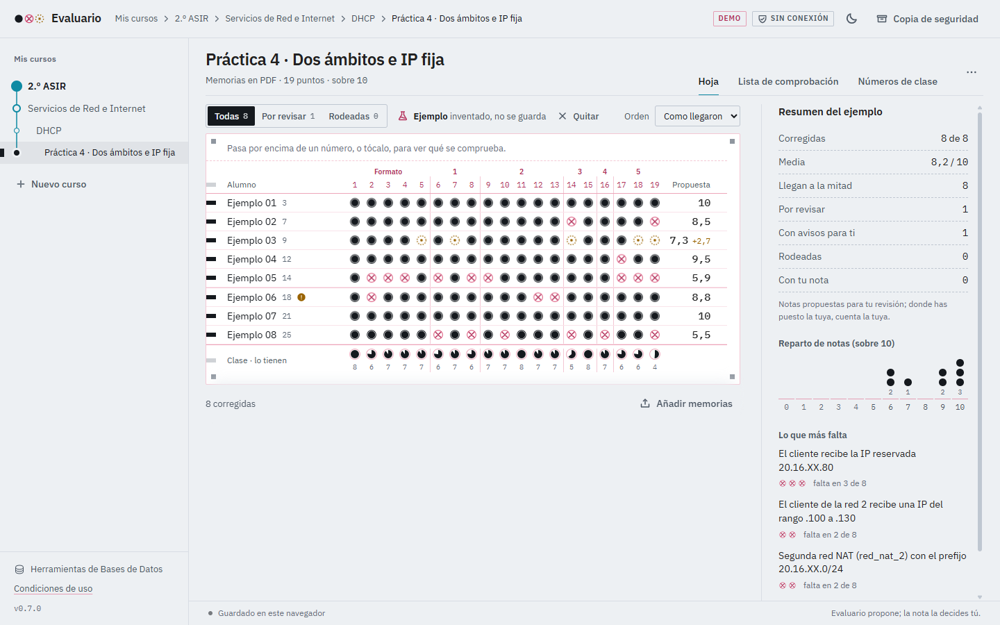
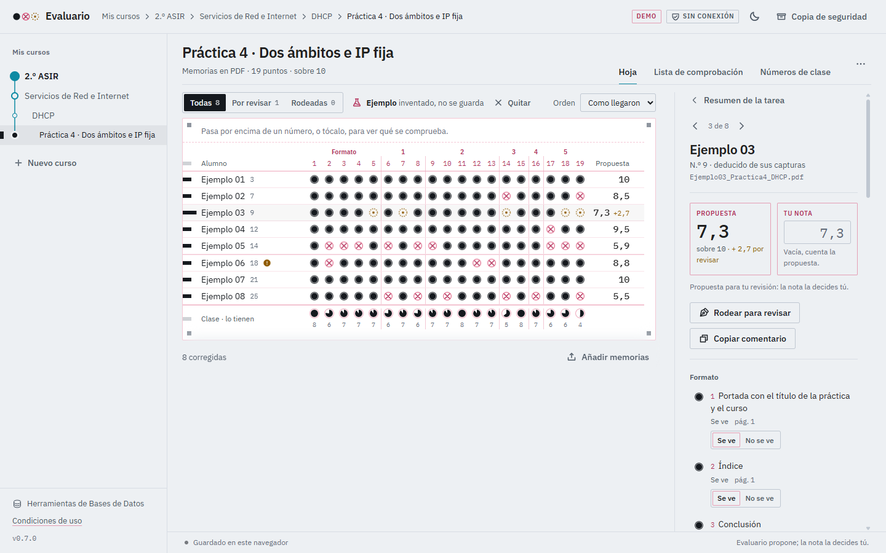
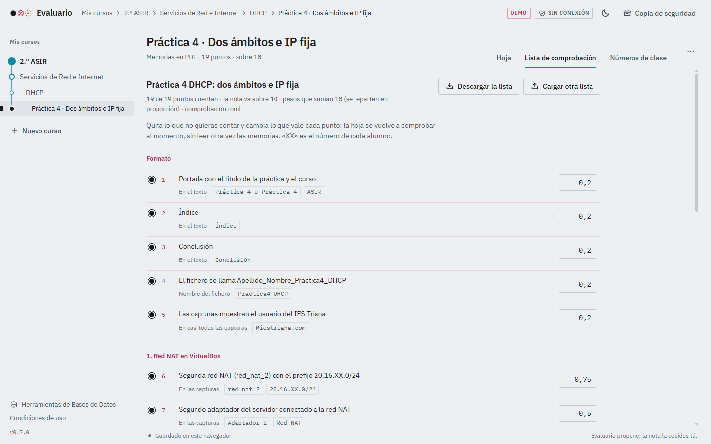

# Prototipos de Interfaz de Usuario

Este documento recoge el diseño de las pantallas principales de **Evaluario**, siguiendo el concepto de *Lector Óptico de Memorias*: cada tarea se visualiza como una hoja de respuestas donde el sistema resalta los hallazgos y el docente valida la calificación final.

---

## 1. Panel Principal de Cursos y Tareas
Organización jerárquica por cursos, asignaturas y temas. Permite consultar el estado global de corrección, la media de notas y el número de entregas pendientes de revisión docente.

---

## 2. Hoja de Corrección y Detalle de Alumno
Vista de lectura óptica alumno por alumno. A la izquierda se muestra la información del estudiante y los puntos comprobados en las capturas del PDF mediante burbujas de estado:
- **Burbuja llena:** Evidencia encontrada con éxito por el OCR.
- **Burbuja con interrogación/punteada:** Evidencia dudosa o con baja confianza para revisión manual del profesor.
- **Burbuja tachada:** Evidencia ausente en la memoria entregada.

---

## 3. Editor de Listas de Comprobación y Rúbricas
Herramienta visual para definir qué textos, órdenes, IPs o salidas de terminal deben buscarse en las capturas de cada práctica, asignando su ponderación y puntuación sin necesidad de editar ficheros de configuración a mano.

